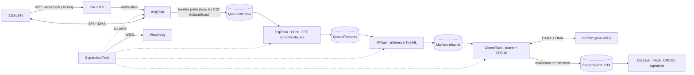

# Architecture logicielle : Nœud de maintenance prédictive

> Document de conception (phase théorique). Les chiffres reprennent `specs.md` : ODR de 1600 Hz, FIFO de 32 niveaux avec watermark à 16, fenêtre FFT de 1024 points avec 50 % de recouvrement, trame envoyée chaque seconde. Les valeurs marquées « à mesurer » seront validées sur la carte.

## 1. Vue d'ensemble

## 2. Tâches

| Tâche | Rôle | Déclencheur | Priorité (FreeRTOS) | Pile de départ (à mesurer) |
|-------|------|-------------|---------------------|----------------------------|
| **AcqTask** | Lit la FIFO de l'ADXL345 (16 entrées), remplit le tampon circulaire | Notification depuis l'interruption INT1 | **5** (la plus haute) | 1 Ko |
| **DspTask** | Copie la fenêtre, fenêtrage Hann, FFT (CMSIS-DSP), RMS, crête, kurtosis, bandes | Message dans `QueueWindow` | 3 | 4 Ko |
| **MlTask** | Inférence TinyML, calcul de la classe et du score | Message dans `QueueFeatures` | 3 | 4 Ko |
| **CommTask** | Construit les trames (CRC16), les envoie à l'ESP32, reçoit les commandes | Période de 1 s + réception UART | 2 | 2 Ko |
| **OtaTask** | Écrit le firmware dans la banque Flash inactive, vérifie CRC32 et signature, bascule | Message de début d'OTA | 2 | 4 Ko (la bibliothèque ECDSA peut demander plus) |
| **SupervisorTask** | Surveille la vivacité des tâches, relance l'IWDG, LED d'état, logs | Période de 500 ms | **1** (la plus basse) | 1 Ko |

**Principe :** plus l'échéance est courte, plus la priorité est haute. L'acquisition a la contrainte la plus dure : la FIFO déborde après 20 ms.

## 3. Interruptions

| Source | Rôle | Action dans l'ISR |
|--------|------|-------------------|
| EXTI (INT1 de l'ADXL345) | Watermark atteint toutes les 10 ms | `vTaskNotifyGiveFromISR` vers AcqTask |
| DMA SPI terminé | Fin de lecture d'une entrée de FIFO | Notification vers AcqTask |
| DMA UART (TX terminé, RX ligne inactive) | Fin d'envoi ou fin de trame reçue | Notification vers CommTask |

**Règles :** utiliser uniquement les fonctions en `...FromISR`, et régler les priorités d'interruption du NVIC (16 niveaux) à une valeur égale ou inférieure à `configMAX_SYSCALL_INTERRUPT_PRIORITY`.

## 4. Communication entre tâches

| Objet | Type | Producteur → consommateur | Taille | Politique si plein |
|-------|------|---------------------------|--------|--------------------|
| Tampon d'échantillons | Tampon circulaire (3 axes × 1024, int16) | AcqTask (écriture) | ≈ 6 Ko | Écrase le plus ancien |
| `QueueWindow` | Queue de messages (index de début de fenêtre) | AcqTask → DspTask | 2 | Compteur d'erreur, fenêtre ignorée |
| `QueueFeatures` | Queue de structures (caractéristiques en float) | DspTask → MlTask | 4 | Supprime la plus ancienne |
| Mailbox résultat | Queue de longueur 1 avec `xQueueOverwrite` | MlTask → CommTask | 1 | Garde toujours le dernier résultat |
| `StreamBuffer` OTA | Flux d'octets | CommTask → OtaTask | 2 Ko | CommTask attend (contrôle de flux) |
| Groupe d'événements | Un bit de vivacité par tâche | Chaque tâche → SupervisorTask | 4 bits | Sans objet |
| Mutex de log | Mutex (héritage de priorité) | Toutes les tâches → UART de debug | 1 | Attente bornée |

**Pourquoi un mutex et non un sémaphore binaire :** le mutex de FreeRTOS applique l'héritage de priorité, ce qui évite l'inversion de priorité.

## 5. Budget temporel

| Événement | Période | Budget de traitement | Remarque |
|-----------|---------|----------------------|----------|
| Watermark ADXL345 (16 échantillons) | 10 ms | ≈ 1 ms pour 16 lectures de 7 octets à ≈ 1,3 MHz (estimation) | Échéance de 20 ms avant débordement de la FIFO |
| Nouvelle fenêtre FFT | 320 ms (512 échantillons) | < 100 ms pour FFT + caractéristiques (à mesurer) | 3 axes traités l'un après l'autre |
| Inférence TinyML | 320 ms | < 100 ms (cible de `specs.md`) | |
| Envoi d'une trame | 1 s | ≈ 13 ms pour ≈ 150 octets à 115200 bauds (estimation) | |
| Transfert OTA | Occasionnel | ≈ 9 s pour 100 Ko à 115200 bauds, hors protocole | Prévoir un débit plus élevé si besoin |

**Charge CPU visée :** moins de 30 % en fonctionnement normal (à mesurer avec les statistiques d'exécution de FreeRTOS).

## 6. Configuration FreeRTOS proposée

| Paramètre | Valeur | Raison |
|-----------|--------|--------|
| Ordonnancement | Préemptif | Respect des échéances |
| Tick | 1 kHz | Résolution de 1 ms suffisante |
| Allocation mémoire | `heap_4` | Fusion des blocs libres |
| Notifications de tâche | Activées | Plus légères que les sémaphores pour les ISR |
| Détection de débordement de pile | Activée (méthode 2) | Fiabilité |
| Statistiques d'exécution | Activées en développement | Mesure de la charge CPU |
| Création des objets | Statique si possible | Pas de fragmentation, comportement prévisible |
| Intégration CubeMX | FreeRTOS via CMSIS-RTOS v2 | Générateur de code de STM32CubeMX |

## 7. Erreurs et watchdog

| Situation | Détection | Réaction |
|-----------|-----------|----------|
| Débordement de la FIFO | Drapeau OVERRUN de l'ADXL345 | Incrémente un compteur, signale dans la trame |
| Fenêtre perdue | `QueueWindow` pleine | Compteur d'erreur, journalisation |
| Tâche bloquée | Bit de vivacité absent dans le groupe d'événements | Le SupervisorTask cesse de relancer l'IWDG : redémarrage |
| Échec de l'OTA | CRC32 ou signature invalide | Conserve l'ancienne banque, notifie l'ESP32 |
| Perte du WiFi | Absence de réponse de l'ESP32 | Tampon local, reprise automatique |

## 8. Points à vérifier

| Point | Action |
|-------|--------|
| Durée réelle de la FFT 1024 points en float sur le STM32G474 | Mesurer avec le compteur de cycles (DWT) |
| Taille de pile nécessaire pour la bibliothèque ECDSA | Mesurer avec `uxTaskGetStackHighWaterMark` |
| Fusion possible de DspTask et MlTask | Décider après mesure (moins de changements de contexte) |
| Brochage (SPI1, UART, INT1) | Définir dans CubeMX, en vérifiant les conflits avec la Nucleo |
